# Juan Pablo Acevedo

Building REST APIs and data-driven systems with Python and Java.

## About

I'm a **Software Engineering student** focused on **Backend Development**, with **Python** as my main language. I build REST APIs, work with relational and NoSQL databases, and enjoy turning business rules into clean, testable code.

I also work with **Java**, **C#**, and **JavaScript**, and I'm comfortable moving across the stack when a project needs it. My main interests are API design, database modeling, and automated testing.

  

## Tech Stack

**Languages**

  

**Backend & Frameworks**

  
  

**Databases**

  
  
  

**Tools**

  

## GitHub Stats

  
  

---

**Backend Development · Python · Java · SQL**

